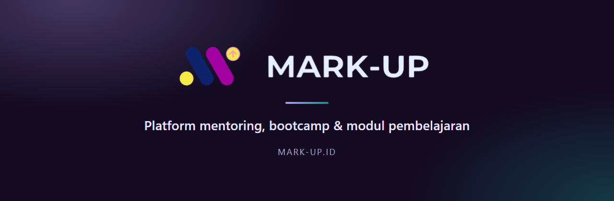
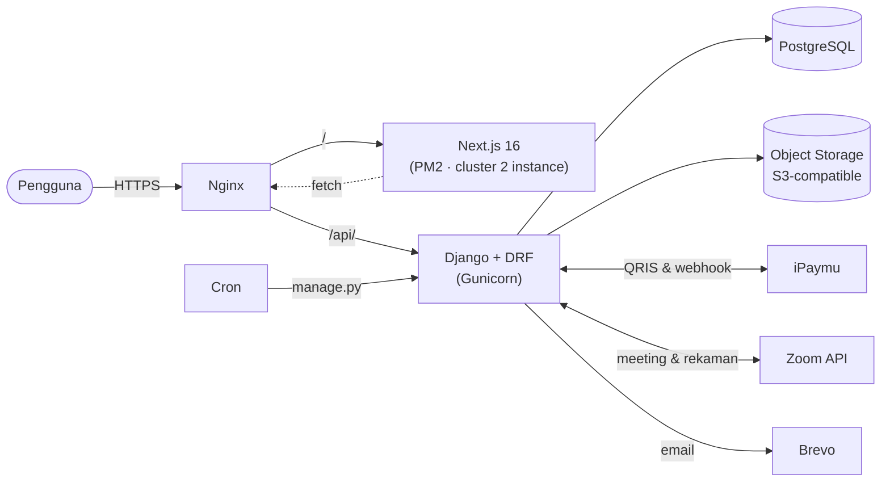

<div align="center">



<br>

[](https://mark-up.id)
[](https://mark-up.id)
[](#-pengujian)


**MARK-UP** adalah platform untuk menjual dan menjalankan program pengembangan diri:
*private mentoring*, *bootcamp*, dan *modul pembelajaran* — lengkap dengan pembayaran otomatis,
penjadwalan mentor, Zoom otomatis, refund, sertifikat, dan dashboard untuk tiap peran.

[Lihat Situs](https://mark-up.id) · [Fitur](#-fitur) · [Mulai Cepat](#-mulai-cepat) · [Deployment](#-deployment) · [Struktur Proyek](#-struktur-proyek)

</div>

---

## 📑 Daftar Isi

- [Fitur](#-fitur)
- [Arsitektur](#-arsitektur)
- [Teknologi](#-teknologi)
- [Mulai Cepat](#-mulai-cepat)
- [Konfigurasi](#-konfigurasi)
- [Pengujian](#-pengujian)
- [Deployment](#-deployment)
- [Integrasi Pihak Ketiga](#-integrasi-pihak-ketiga)
- [Struktur Proyek](#-struktur-proyek)
- [Keamanan](#-keamanan)
- [Kontributor](#-kontributor)

---

## ✨ Fitur

### 🎓 Untuk Pembeli (Mentee)
| | |
|---|---|
| **Katalog produk** | Mentoring, bootcamp, dan modul dengan detail, harga, diskon, dan ulasan. |
| **Checkout fleksibel** | Bayar otomatis lewat **QRIS (iPaymu)** atau **transfer manual** dengan unggah bukti. Mendukung kode referral. QRIS bisa **diunduh** sebagai gambar. |
| **Pilih mentor & jadwal sendiri** | Pilih mentor berdasarkan keahlian dan slot yang tersedia; jadwal bisa diubah dari dashboard. |
| **Produk Saya** | Akses semua produk yang dibeli, progres sesi, link Zoom, dan **rekaman sesi**. |
| **Bootcamp** | Pendaftaran dengan dokumen, seleksi (kuis berwaktu), pembayaran setelah diterima, tim, dan sumber belajar per paket. |
| **Refund** | Ajukan refund dari halaman produk dengan batas waktu yang jelas, pantau statusnya, dan lihat **bukti transfer** pengembalian dana. |
| **Invoice** | Invoice berlogo yang bisa dicetak atau disimpan sebagai PDF. |
| **Notifikasi** | Lonceng di dashboard **dan** email untuk setiap kabar penting. |
| **Rating, sertifikat, kompetisi** | Beri ulasan setelah program selesai, unduh sertifikat, dan lihat daftar kompetisi. |

### 🧑‍🏫 Untuk Mentor
- Kelola **ketersediaan jadwal** (tambah satuan atau massal, bentrok otomatis ditolak).
- Daftar **kelas aktif** dan jadwal sesi, lengkap dengan data mentee dan link Zoom.
- Lihat **ulasan** dan **honor** yang tercatat per sesi.
- Profil yang **otomatis tampil** di halaman Mentor begitu datanya lengkap.
- Dapat email **booking baru**, perubahan jadwal, pembatalan, dan **pengingat 3 jam** sebelum sesi.

### 🛠️ Untuk Admin
- **Dashboard** ringkasan penjualan dengan grafik pendapatan.
- **Produk & pesanan**: CRUD produk, pesanan mentoring/bootcamp/modul, verifikasi transaksi.
- **Refund**: setujui dengan persentase potongan, nominal tercatat, dan unggah bukti transfer.
- **Pencairan mentor** (payout) dengan komisi global atau khusus per mentor.
- **Manajemen user**: peran, status akun, dan **status mentor** (aktif / data belum lengkap / dinonaktifkan).
- **Kode referral**, **seleksi bootcamp**, **sertifikat**, **kompetisi**, **broadcast email**.
- **Audit trail**, **data explorer**, pesan kontak, dan kotak masuk ulasan.
- **Pengaturan** akun Zoom (status **PRO / GRATIS**), iPaymu, dan rekening pembayaran.

### 🤖 Otomatisasi
| Tugas | Frekuensi |
|---|---|
| Lepas reservasi pembayaran yang kedaluwarsa (15 menit) dan pulihkan pembayaran iPaymu yang telat | tiap 2 menit |
| Buat **link Zoom terbuka** (tanpa host, durasi +30 menit, rekam cloud otomatis) | tiap 15 menit |
| Kirim **pengingat** sesi (24 jam & 3 jam), pengingat pilih jadwal, dan **tandai sesi selesai** otomatis | tiap 10 menit |
| Tarik **link rekaman** Zoom lalu kabari pembeli & mentor | tiap jam |
| **Backup database** | tiap hari, 02.00 |

---

## 🧩 Arsitektur



Frontend dan backend dilayani dari **satu domain** lewat Nginx (`/` ke Next.js, `/api/` ke Django),
jadi request API bersifat *same-origin* dan tidak perlu pengaturan CORS di produksi.

---

## 🧰 Teknologi

| Lapisan | Teknologi |
|---|---|
| **Frontend** | Next.js 16 (App Router), React 19, Tailwind CSS 4, Radix UI / shadcn, Framer Motion, Recharts, Zustand, Sonner |
| **Backend** | Django, Django REST Framework, SimpleJWT, Gunicorn, WhiteNoise |
| **Database** | PostgreSQL |
| **Penyimpanan berkas** | S3-compatible object storage (`django-storages` + `boto3`), fallback ke disk lokal |
| **Pembayaran** | iPaymu (QRIS + webhook) dan transfer manual |
| **Meeting** | Zoom Server-to-Server OAuth |
| **Email** | Brevo API (atau SMTP) |
| **Login** | Email + password (JWT) dan Google Sign-In |
| **Infrastruktur** | Nginx, systemd, PM2, cron, Linux VPS |

---

## 🚀 Mulai Cepat

### Prasyarat
- **Python 3.12+**
- **Node.js 20+** dan npm
- **PostgreSQL** (user database perlu izin `CREATEDB` untuk menjalankan tes)

### 1. Ambil kode
```bash
git clone https://github.com/MarkUp-IT/Mark-Up.git
cd Mark-Up
```

### 2. Backend (Django)
```bash
cd Backend
python -m venv .venv
source .venv/bin/activate          # Windows: .venv\Scripts\activate
pip install -r requirements.txt

cp .env.production.example .env    # lalu isi nilainya, lihat bagian Konfigurasi
python manage.py migrate
python manage.py seed_test_accounts   # akun contoh, KHUSUS development (jangan di produksi)
python manage.py runserver            # http://localhost:8000
```

### 3. Frontend (Next.js)
```bash
cd Frontend
npm install
cp .env.production.example .env.local
# isi NEXT_PUBLIC_API_BASE_URL=http://localhost:8000
npm run dev                        # http://localhost:3000
```

> 💡 Untuk development lokal, isi `DEBUG=True`, `PRODUCTION=False`, dan
> `DB_ENGINE=django.db.backends.postgresql` di `Backend/.env`.
> Tanpa kredensial SMTP/Brevo, email dicetak ke konsol; tanpa S3, berkas disimpan di folder lokal.

---

## 🔧 Konfigurasi

Salin `Backend/.env.production.example` dan `Frontend/.env.production.example`, lalu isi nilainya.
**Jangan pernah meng-commit file `.env` yang sudah terisi.**

<details>
<summary><b>Variabel lingkungan Backend</b></summary>

| Variabel | Fungsi |
|---|---|
| `SECRET_KEY`, `DEBUG`, `PRODUCTION`, `ALLOWED_HOSTS` | Pengaturan inti Django |
| `FRONTEND_URL`, `FRONTEND_URL_ALT` | Domain frontend (CORS/CSRF dan link di email) |
| `DB_ENGINE`, `DB_NAME`, `DB_USER`, `DB_PASSWORD`, `DB_HOST`, `DB_PORT` | Koneksi PostgreSQL |
| `BREVO_API_KEY` | Kirim email lewat Brevo (diutamakan bila terisi) |
| `EMAIL_HOST`, `EMAIL_PORT`, `EMAIL_HOST_USER`, `EMAIL_HOST_PASSWORD`, `EMAIL_USE_TLS`, `DEFAULT_FROM_EMAIL` | Alternatif SMTP |
| `TEAM_NOTIFICATION_EMAIL` | Inbox tim untuk notifikasi internal dan alamat *Reply-To* |
| `S3_ENDPOINT_URL`, `S3_ACCESS_KEY_ID`, `S3_SECRET_ACCESS_KEY`, `S3_BUCKET_NAME`, `S3_REGION_NAME` | Penyimpanan berkas S3-compatible (kosongkan untuk disk lokal) |
| `GOOGLE_CLIENT_ID` | Login Google (kosongkan untuk menonaktifkan) |
| `ZOOM_CRED_KEY` | Kunci Fernet untuk mengenkripsi kredensial akun Zoom di database |
| `IPAYMU_CRED_KEY` | Kunci Fernet terpisah untuk API key iPaymu |
| `ZOOM_EXTRA_MINUTES` | Waktu cadangan di meeting Zoom (default `30`) |
| `SESSION_AUTO_COMPLETE_HOURS` | Jeda sebelum sesi ditandai selesai otomatis (default `2`) |

Membuat kunci Fernet:
```bash
python -c "from cryptography.fernet import Fernet; print(Fernet.generate_key().decode())"
```
</details>

<details>
<summary><b>Variabel lingkungan Frontend</b></summary>

| Variabel | Fungsi |
|---|---|
| `NEXT_PUBLIC_API_BASE_URL` | Alamat API (di produksi: domain yang sama dengan situs) |
| `NEXT_PUBLIC_GOOGLE_CLIENT_ID` | Harus sama dengan `GOOGLE_CLIENT_ID` di backend |
| `NEXT_PUBLIC_S3_PUBLIC_URL` | Domain object storage, agar gambar diizinkan oleh CSP |
</details>

Kredensial **iPaymu** dan **Zoom** disimpan terenkripsi di database dan diatur lewat panel admin
(halaman *Transaksi* dan *Pesanan Mentoring*), bukan lewat file `.env`.

---

## 🧪 Pengujian

Backend punya **192 tes otomatis** yang mencakup alur pembayaran, refund, iPaymu, jadwal mentoring,
bootcamp, matriks izin akses seluruh endpoint, pengecekan IDOR, dan *smoke test* input sampah.

```bash
cd Backend
python manage.py test --settings=mark_up.test_settings
```

`mark_up.test_settings` memakai database tes terpisah yang otomatis dibuat dan dibuang, email dan cache
di memori, serta penyimpanan berkas di memori — jadi **tidak menyentuh data asli**. Panggilan ke
iPaymu dan Zoom di-*mock* di dalam tiap tes.

---

## 🌐 Deployment

Konfigurasi server ada di folder [`deploy/`](deploy): `nginx.conf`, `nginx-ratelimit.conf`,
`gunicorn.service`, dan `deploy.sh`.

**Backend** (tanpa downtime):
```bash
cd Backend
source .venv/bin/activate
python manage.py migrate --noinput
python manage.py collectstatic --noinput
sudo systemctl kill -s HUP gunicorn      # reload bergiliran, tanpa memutus request
```

**Frontend** (tanpa downtime):
```bash
cd Frontend
./deploy-frontend.sh
```
Skrip ini membangun ke folder terpisah, menyalin aset versi lama agar pengunjung yang masih membuka
halaman lama tidak kena 404, menukar folder, lalu me-*reload* PM2 (2 instance) bergiliran.
Versi sebelumnya disimpan di `.next-old` untuk rollback cepat.

**Cron** yang harus terpasang di server (`crontab -e`; di server asli keluaran tiap perintah
dialihkan ke `/var/log/markup_*.log`):

```cron
0 2 * * *    cd /var/www/markup/Backend && ./.venv/bin/python manage.py backup_database
*/2 * * * *  cd /var/www/markup/Backend && ./.venv/bin/python manage.py expire_stale_transactions
*/10 * * * * cd /var/www/markup/Backend && ./.venv/bin/python manage.py send_mentoring_reminders --execute
*/15 * * * * cd /var/www/markup/Backend && ./.venv/bin/python manage.py generate_zoom_links --execute
17 * * * *   cd /var/www/markup/Backend && ./.venv/bin/python manage.py fetch_zoom_recordings --execute
```

> Perintah yang bisa mengirim email atau membuat meeting berjalan **dry-run** secara bawaan;
> tambahkan `--execute` untuk benar-benar menjalankannya.

---

## 🔌 Integrasi Pihak Ketiga

| Layanan | Dipakai untuk | Catatan |
|---|---|---|
| **iPaymu** | Pembayaran QRIS otomatis | Status lunas selalu **dikonfirmasi ke API iPaymu** (bukan percaya isi webhook mentah) |
| **Zoom** | Meeting mentoring & rekaman | Server-to-Server OAuth. **Butuh akun Pro** untuk rekaman cloud dan sesi lebih dari 40 menit |
| **Brevo** | Email transaksional | Email HTML bertema MARK-UP, dikirim di thread terpisah supaya tidak menahan request |
| **Google Identity** | Login dengan Google | Opsional |
| **S3-compatible storage** | Foto profil, CV, bukti bayar, bukti refund | Berkas diakses lewat *presigned URL* berbatas waktu |

---

## 📂 Struktur Proyek

```
Mark-Up/
├── Backend/                  # Django REST API
│   ├── accounts/             # pengguna, autentikasi, notifikasi, audit log, broadcast email
│   ├── products/             # produk, bootcamp, mentoring, refund, ulasan, kuis, akun Zoom
│   ├── transactions/         # checkout, iPaymu, kode referral, payout, invoice
│   ├── mentors/              # profil mentor, keahlian, ketersediaan jadwal
│   ├── programs/             # template sesi bootcamp
│   └── mark_up/              # settings, klien Zoom/iPaymu, email, storage, utilitas tes
├── Frontend/                 # Next.js (App Router)
│   └── src/
│       ├── app/
│       │   ├── (public)/     # beranda, katalog, checkout, mentor, FAQ, kebijakan
│       │   ├── (auth)/       # login, daftar, verifikasi, reset password
│       │   ├── (dashboard)/  # dashboard admin / mentor / user
│       │   └── invoice/      # halaman invoice (cetak / PDF)
│       ├── component/        # komponen UI bersama
│       └── lib/              # klien API, hook, utilitas
├── deploy/                   # nginx, gunicorn, skrip deploy
└── docs/                     # aset dokumentasi
```

---

## 🔒 Keamanan

- **Autentikasi JWT** dengan pengecekan status akun di setiap request; akun yang dinonaktifkan langsung ditolak.
- **Akses berbasis peran** (admin / mentor / user) di tiap endpoint, diuji lewat matriks izin otomatis dan tes IDOR.
- **Kredensial Zoom dan iPaymu terenkripsi** (Fernet) di database dengan kunci terpisah.
- **Rate limiting** pada login, registrasi, lupa password, dan endpoint yang memanggil layanan luar.
- **Validasi unggahan**: tipe berkas diperiksa isinya (bukan hanya ekstensi) dan ukurannya dibatasi.
- **Audit trail** untuk aksi administratif.
- **Pembayaran**: transaksi dikunci di tingkat database untuk mencegah pembayaran ganda dan kondisi balapan.

Menemukan celah keamanan? Mohon jangan buka *issue* publik — hubungi tim lewat **markup.ofc@gmail.com**.

---

## 👥 Kontributor

<a href="https://github.com/MarkUp-IT/Mark-Up/graphs/contributors">
  
</a>

---

<div align="center">

Dibuat dengan ☕ oleh tim **MARK-UP** · Surabaya, Indonesia

[mark-up.id](https://mark-up.id) · [markup.ofc@gmail.com](mailto:markup.ofc@gmail.com)

</div>
